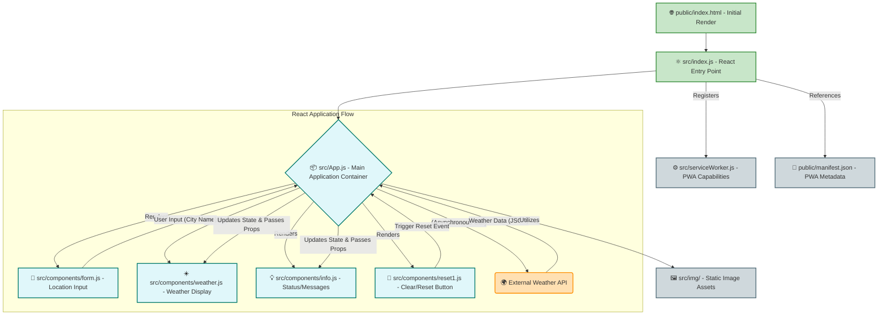

# ☀️ pogoda_2_test_150921 - React Weather Application 🌦️

This repository hosts a modern, component-driven web application built with React, designed to fetch and display real-time weather information. Named `pogoda` (meaning "weather" in Slavic languages), this project serves as a clear example of building a responsive and interactive user interface with a focus on a core utility: weather forecasting. The "150921" suffix likely indicates its creation or a significant update date (September 15, 2021).

## 🚀 Features

This application provides users with an intuitive way to retrieve weather data for various locations, enhanced by a responsive design and Progressive Web App (PWA) capabilities.

*   **Location-Based Weather Search**: Users can input a city name to fetch and display current weather conditions.
*   **Real-Time Weather Display**: Presents essential weather metrics such as temperature, humidity, wind speed, and general conditions (e.g., cloudy, sunny). *(Assumed functionality based on 'weather' components)*.
*   **Component-Driven Architecture**: Structured with reusable React components for maintainability and scalability.
*   **Responsive User Interface**: Utilizes Bootstrap for a consistent and adaptive layout across different devices.
*   **Progressive Web App (PWA) Ready**: Implements a service worker and manifest file, enabling offline capabilities, faster load times, and installability on user devices.
*   **Informative Feedback**: Provides user-friendly messages for loading states, errors, or instructional prompts.
*   **Reset Functionality**: Offers a clear mechanism to reset the input form or displayed weather data.

## 🛠 Technology Stack

The application is built upon a robust and popular set of web technologies, primarily focusing on the React ecosystem.

*   **Frontend Development**:
    *   **React (v16.13.1)**: A declarative, component-based JavaScript library for building user interfaces.
    *   **JavaScript (ES6+)**: The core programming language for application logic and interactivity.
    *   **HTML5**: The foundation for structuring web content.
    *   **CSS3**: For styling and visual presentation, including custom styles (`App.css`, `index.css`).
    *   **Bootstrap (v4.5.2)**: A widely used CSS framework for responsive and mobile-first frontend development.
*   **Tooling & Environment**:
    *   **Create React App (v3.4.3)**: Official setup for building single-page React applications, providing a modern build setup with no configuration.
    *   **npm**: Node Package Manager for managing project dependencies and running scripts.
    *   **Node.js**: JavaScript runtime environment (required for npm and development server).
*   **Testing**:
    *   **Jest**: A JavaScript testing framework for unit and snapshot testing.
    *   **React Testing Library**: A set of utilities for testing React components in a user-centric way.

## 🏗 Architecture / Workflow

This React application follows a standard component-based architecture orchestrated by `Create React App`. The flow begins from the entry point (`index.js`) and delegates control to the main `App` component, which then manages the state and orchestrates interactions with child components.



**Workflow Breakdown:**

1.  **Initialization**: `public/index.html` loads `src/index.js`, which serves as the React application's entry point, rendering the main `App` component into the DOM.
2.  **User Interaction**: The user interacts with the `Form` component to input a desired city name.
3.  **Data Fetching**: The `App` component, acting as a central state manager, receives the city input. It then asynchronously fetches weather data from an external Weather API (e.g., OpenWeatherMap, AccuWeather).
4.  **State Management**: Upon receiving data from the API, the `App` component updates its internal state.
5.  **UI Updates**: The `Weather` component receives weather data as props from `App` and displays it. The `Info` component provides status messages (e.g., "Loading...", "Enter city," or error messages) based on the `App`'s state.
6.  **Reset Functionality**: The `Reset1` component, typically a button, triggers a reset event in `App`, clearing inputs or displayed data.
7.  **PWA Integration**: `src/serviceWorker.js` is registered by `src/index.js` to enable caching of assets, providing offline access and faster subsequent loads. `public/manifest.json` defines the PWA's metadata for installation on devices.

## 📂 Project Structure

The project adheres to the standard `Create React App` directory structure, promoting clear separation of concerns.

```
.
├── public/                 # Static assets and PWA configuration
│   ├── index.html          # Main HTML file for the application
│   └── manifest.json       # Web App Manifest for PWA features
├── src/                    # All application source code
│   ├── components/         # Reusable React components
│   │   ├── form.js         # Component for city input
│   │   ├── info.js         # Component for displaying messages/status
│   │   ├── reset1.js       # Component for reset/clear functionality
│   │   └── weather.js      # Component for displaying weather details
│   ├── img/                # Image assets used in the application
│   │   └── cloudy.png      # Example weather icon
│   ├── App.css             # Styles specific to the main App component
│   ├── App.js              # Main application component, orchestrates other components
│   ├── App.test.js         # Jest tests for the App component
│   ├── index.css           # Global styles for the application
│   ├── index.js            # Entry point of the React application
│   └── serviceWorker.js    # Script for Progressive Web App (PWA) features
├── package.json            # Project dependencies and scripts
├── package-lock.json       # Exact dependency tree
└── README.md               # Project documentation
```

## ⚙️ Installation / Quick Start

Follow these steps to set up and run the `pogoda_2_test_150921` application locally.

1.  **Clone the Repository**:
    Begin by cloning the project from GitHub to your local machine.
    ```bash
    git clone https://github.com/iv150320/pogoda_2_test_150921.git
    cd pogoda_2_test_150921
    ```

2.  **Install Dependencies**:
    Navigate into the project directory and install all required Node.js packages using npm.
    ```bash
    npm install
    ```

3.  **Configure API Key (Optional but Recommended)**:
    This application likely fetches weather data from an external API. While not explicitly visible in the provided files, it's best practice to handle API keys securely.
    *   Obtain an API key from your chosen weather service (e.g., OpenWeatherMap).
    *   Create a `.env` file in the root directory of the project.
    *   Add your API key to the `.env` file (e.g., `REACT_APP_WEATHER_API_KEY=YOUR_API_KEY_HERE`).
    *   *Note*: The application code would need to be updated to consume this environment variable (`process.env.REACT_APP_WEATHER_API_KEY`).

4.  **Start the Development Server**:
    Launch the application in development mode. This will open the app in your default web browser (usually at `http://localhost:3000`).
    ```bash
    npm start
    ```

5.  **Build for Production (Optional)**:
    To create an optimized production build of the application, run:
    ```bash
    npm run build
    ```
    This command will compile the app into static files in the `build/` directory, ready for deployment.

---
**Author**: @iv150320